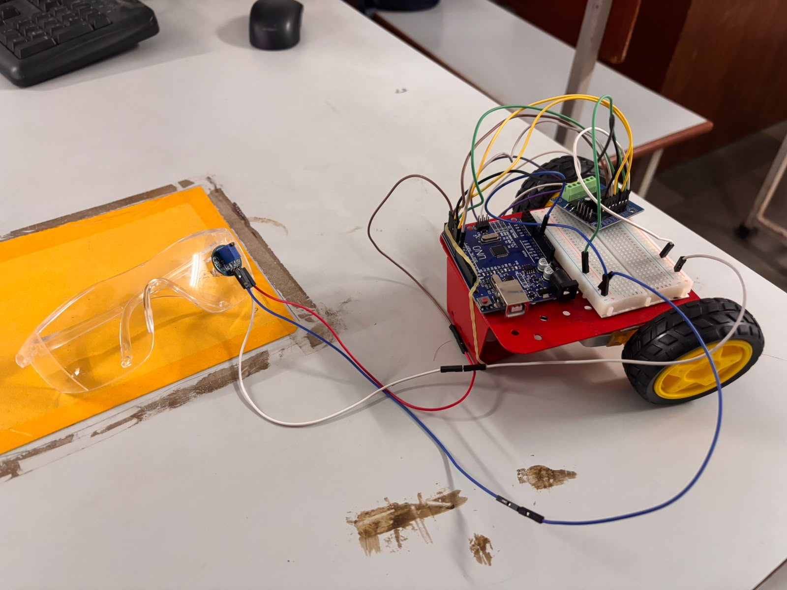
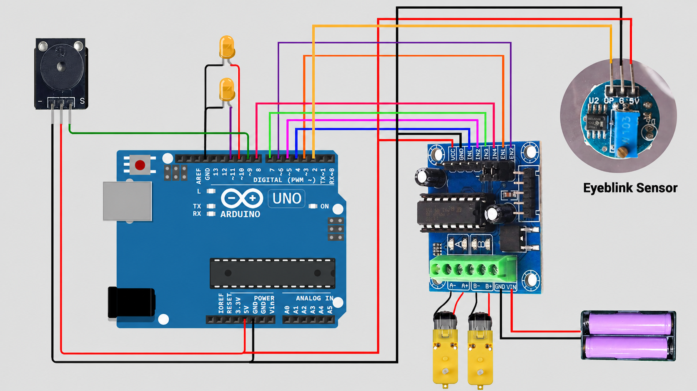

# Driver Drowsiness Detection System

A low-cost Arduino prototype that detects sustained eye closure using an
infrared eye blink sensor and responds by stopping the motors and
sounding a buzzer and LEDs.

> ⚠️ This is a learning and demonstration prototype, not a validated safety device.

## How it works
1. The IR eye blink sensor outputs LOW when the eye is closed and HIGH when open.
2. The Arduino counts consecutive LOW readings; any HIGH reading resets the counter.
3. At 1200 consecutive readings (about 7.5 s with the current serial output),
   the motor PWM ramps from 255 to 0 in about 1.3 s.
4. The buzzer and both LEDs then flash at 250 ms ON / 250 ms OFF until reset.

## Hardware
| Component | Purpose |
|---|---|
| Arduino Uno R3 | Main controller |
| IR eye blink sensor | Eye open/closed detection |
| L293D motor driver | Drives the DC motors |
| DC motors, wheels, chassis | Demo platform |
| Buzzer + 2 LEDs | Audible and visual alert |
| 18650 cells + holder | Portable power |

## Pin assignments
| Signal | Arduino pin |
|---|---|
| Eye blink sensor | 2 |
| Motor enable 1 (PWM) | 3 |
| Motor inputs 1, 2 | 4, 5 |
| Motor enable 2 (PWM) | 6 |
| Motor inputs 3, 4 | 7, 8 |
| Buzzer | 9 |
| LEDs | 10, 11 |

## Setup
1. Wire the circuit as shown above.
2. Open `drowsiness_detection/drowsiness_detection.ino` in the Arduino IDE.
3. Select **Arduino Uno** and the correct port, then upload.
4. Open the Serial Monitor at 9600 baud to see the sensor readings.
5. Adjust the sensor potentiometer so it reads LOW only when the eye is closed.
6. Test with the wheels raised.

## Known limitations
- Timing is calculated from the loop time (serial printing), not measured.
- The alert latches until reset (`while(1)`).
- 7.5 s is too long for real use; a `millis()`-based timer at about 3 s is planned.

## Future work
- `millis()`-based detection timer
- Reset/recovery mechanism
- Signal filtering to reduce false alerts
- Measured detection delay and false-alert rate

## Credits
Sketch based on the "Driver Drowsiness Detection Project" tutorial by
[Tech at Home](https://youtu.be/8Pv5BLHULSY).

## Team
Hisham Shariq Abdullah, Amaan Fareed Ahmed, Atif Dadan Bashir, Bulhasan Syed Ali

Guide: Prof. Farhan Shaikh, Rizvi College of Engineering, University of Mumbai

## License
MIT
